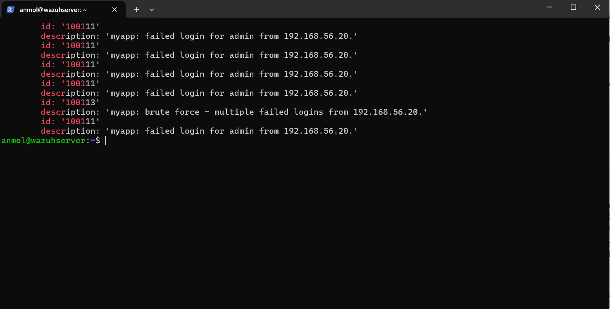
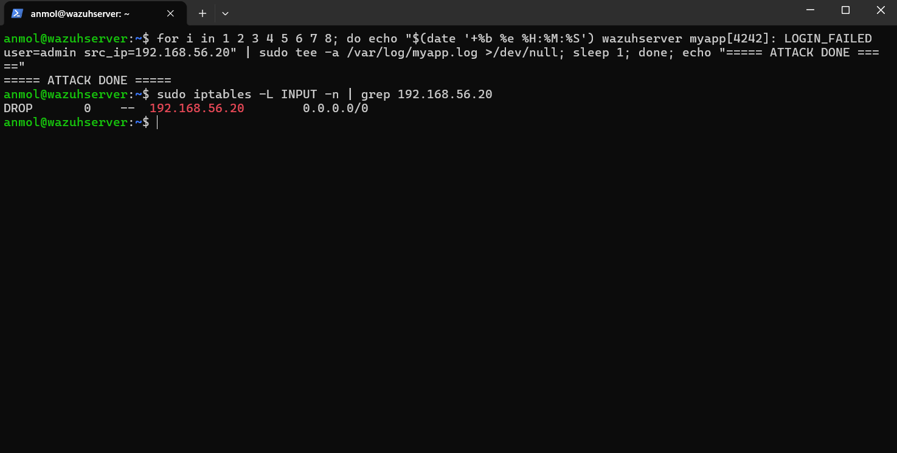
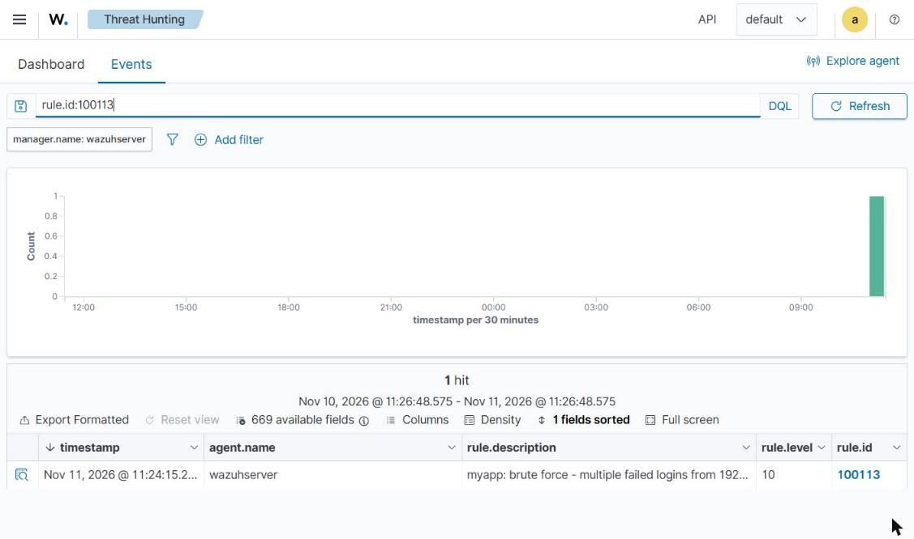
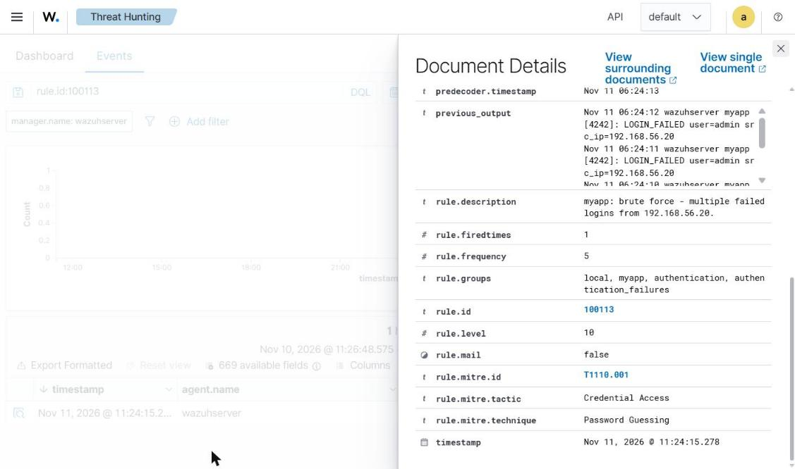
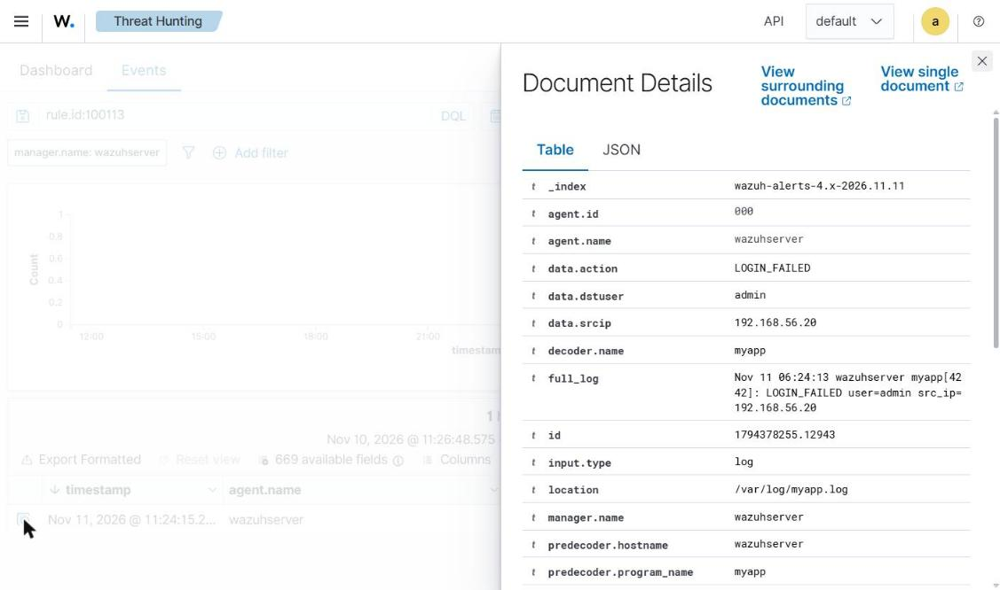

# Wazuh Brute-Force Detection & Response Lab

A home SOC lab built on [Wazuh](https://wazuh.com) (open-source SIEM/XDR) that detects SSH and web-app brute-force attacks, maps them to MITRE ATT&CK, and automatically blocks the attacker's IP.

> All attack simulations in this repo are meant **only** for machines you own inside an isolated lab network.

## What this project shows

| Skill | How it's shown |
|---|---|
| SIEM deployment | Wazuh 4.14 all-in-one on Ubuntu Server 24.04 (VirtualBox) |
| Log collection | Wazuh monitors `auth.log` and a custom app log |
| Custom decoders | Parses a custom application log format (`decoders/local_decoder.xml`) |
| Custom detection rules | Root logins, off-hours logins, app brute force (`rules/local_rules.xml`) |
| Correlation | Frequency-based rule: 5 failed logins from one IP in 60 s |
| MITRE ATT&CK mapping | T1110 Brute Force, T1110.001 Password Guessing, T1078 Valid Accounts |
| Active response | `firewall-drop` blocks the source IP for 3 minutes (verified with iptables) |
| Testing | Sample logs validated with `wazuh-logtest` |

## Architecture

Single-VM home lab (VirtualBox on Windows). The Wazuh server monitors its own logs, so it is also the "victim".

```
 +----------------------+   host-only network    +-------------------------------+
 |  Windows 11 host     |  192.168.56.0/24       |  Ubuntu Server 24.04 VM       |
 |  - SSH admin         +----------------------->+  Wazuh 4.14 all-in-one        |
 |  - Dashboard (HTTPS) |                        |  manager + indexer + dashboard|
 |  192.168.56.1        |                        |  monitors /var/log/myapp.log  |
 +----------------------+                        |  192.168.56.102               |
                                                 +-------------------------------+
```

| Component | Spec |
|---|---|
| Host | Windows 11, VirtualBox 7.2 |
| VM | Ubuntu Server 24.04.5 LTS, 8 GB RAM, 4 vCPU, 50 GB disk |
| NICs | Adapter 1 NAT (internet), Adapter 2 host-only (lab access) |
| SIEM | Wazuh 4.14.10 all-in-one |

## Setup

1. **Install Wazuh** (on the VM, over SSH):
   ```bash
   curl -sO https://packages.wazuh.com/4.14/wazuh-install.sh && sudo bash ./wazuh-install.sh -a
   ```
   Open `https://<VM-IP>` and log in as `admin` with the password printed at the end.

2. **Deploy the custom decoder and rules:**
   ```bash
   git clone https://github.com/AnmolNisar/wazuh-bruteforce-detection-lab.git
   cd wazuh-bruteforce-detection-lab
   sudo bash lab-setup/deploy-rules.sh
   ```

3. **Collect the app log and enable active response:** append `config/manager-ossec-snippet.xml` to `/var/ossec/etc/ossec.conf`, then:
   ```bash
   sudo touch /var/log/myapp.log && sudo systemctl restart wazuh-manager
   ```

## Test the detections

**1. Offline rule test with `wazuh-logtest`:**
```bash
sudo /var/ossec/bin/wazuh-logtest < tests/myapp_sample.log
```
After 5 failed logins from the same IP, rule `100113` fires.

**2. Live attack simulation** (writes 8 failed logins from `192.168.56.20`):
```bash
sudo bash attack-sim/generate_app_logs.sh 192.168.56.20 8
```

**3. Verify the automatic block:**
```bash
sudo iptables -L INPUT -n | grep 192.168.56.20
# DROP  all  --  192.168.56.20  0.0.0.0/0
```

**4. Dashboard:** Threat intelligence -> Threat Hunting -> Events, query `rule.id:100113`.

## Custom rules

| ID | Level | Detects | MITRE |
|---|---|---|---|
| 100100 | 10 | Successful SSH login as `root` | T1078 |
| 100101 | 8 | Successful SSH login outside 08:00–18:00 | T1078 |
| 100110 | 0 | Groups all `myapp` events | – |
| 100111 | 5 | `myapp` failed login | T1110 |
| 100112 | 3 | `myapp` successful login | T1078 |
| 100113 | 10 | 5+ `myapp` failed logins from one IP in 60 s | T1110.001 |

## Results

**Custom rule tested with wazuh-logtest:** the 5th failed login triggers rule 100113



**Active response blocks the attacker IP automatically**



**Alert in the Wazuh dashboard (level 10, MITRE T1110.001)**



**Alert details: MITRE ATT&CK mapping (T1110.001 Credential Access / Password Guessing), level 10, frequency 5**



**Decoded fields from the custom decoder (action, user, source IP)**



## What I learned

- How a SIEM is built: the agent/manager collects logs, **decoders** pull out fields (user, source IP), **rules** decide what is suspicious, and the indexer + dashboard store and show alerts.
- How to write a **correlation rule** (`frequency` + `timeframe` + `same_srcip`) that turns many low-level events into one high-severity alert.
- How **active response** closes the loop from detection to response by adding a temporary firewall block.
- Practical Linux troubleshooting: broken package dependencies, a failing mirror, a wrong VM clock, and hash mismatches fixed by switching to HTTPS.
- Always test rules offline with `wazuh-logtest` before trusting them live.

## Repo layout

```
lab-setup/   install & deploy scripts
decoders/    custom decoder for myapp logs
rules/       custom detection rules
config/      ossec.conf snippet (log collection + active response)
attack-sim/  scripts to generate test traffic (lab only)
tests/       sample logs for wazuh-logtest
docs/        roadmap, LinkedIn post template, screenshots
```

## License

MIT
